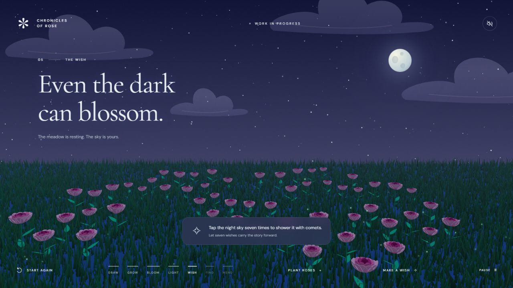

# Chronicles of Rose

**Work in progress — an early interactive story project.**

[Play the project](https://yum-yum-thighs.github.io/chronicles-of-rose/)

Draw a horizon, grow a rose garden, place the sun, and make wishes. When the moon
breaks, guide a rose light through a procedural meadow, collect eight fragments,
and bring them together again.

This project explores how simple player actions can shape a story and its world.
It was developed with AI assistance and is being shared as an early portfolio
project. Visuals, pacing, controls, and performance may change as development
continues.



## Play

1. Draw from the glowing left dot to the right edge. Use **Use keyboard** and the
   arrow keys if you prefer keyboard drawing.
2. Click or brush the grass to plant eight rose patches. Keyboard mode also
   provides a **Plant a patch** button.
3. Place the sun in the sky and watch it set.
4. Make seven wishes in the night sky to begin the moon chapter.
5. Guide the rose light using the mouse, touch, WASD, arrow keys, or on-screen
   controls. **Call the wind** gives a clue; **Glide with the wind** offers
   optional guidance.
6. Tap each recovered fragment or drag it into the moon to restore it.

Sound starts off. **Pause** holds the story. **Start again** resets the world.
Progress lasts for the current session; reloading starts a new story. A browser
with WebGL support is required.

## Run locally

Install Node.js, then run these commands from the project directory:

```text
node server.mjs
```

Open http://127.0.0.1:5199. No package installation or build step is required.

```text
node --test tests/*.test.mjs
```

## How it works

- `story.js` connects the controls, procedural Three.js garden, animation, and
  optional synthesized sound.
- `story-state.js` controls chapter transitions and interaction gates.
- `garden-layout.js` finds planting space and prevents overlapping rose patches.
- `moon-quest.js` displays the search and moon assembly chapters.
- `quest-state.js` manages steering, collection, bounds, and optional guidance.
- `meadow-world.js` generates repeatable terrain and fragment locations.
- `meadow-stream.js` loads nearby terrain tiles while the light moves.

The site runs entirely in the browser. GitHub Pages serves the files from `main`.
The local server is only a preview tool.

## Credits

See [CREDITS.md](CREDITS.md) for Three.js licensing and visual inspirations.
No third-party game assets or recordings are bundled. A reuse license for the
project's own code has not been selected.

## Verification

See [verification/README.md](verification/README.md) for release checks and limits.
