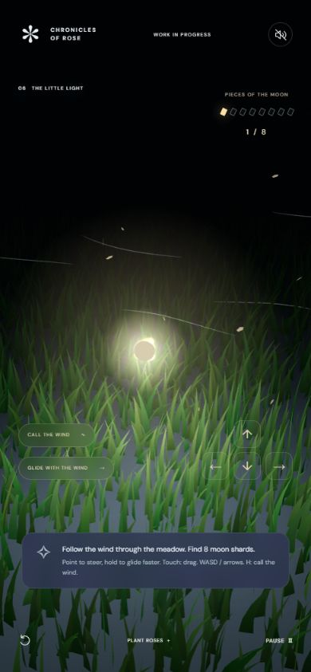

# Release verification

Checked on 14 October 2026.

- All 27 existing tests passed after adapting their imports to the public layout.
  They cover chapter gates, sunset timing, planting space, moon collection and
  restoration, steering, guidance, and deterministic terrain streaming.
- All eight authored JavaScript modules passed Node.js syntax checks.
- All 17 local application references resolved to included files.
- Desktop browser: keyboard horizon drawing, planting eight patches, sun
  placement and sunset, seven wishes, moon fracture and search, wind hint,
  assisted fragment collection, pause/continue, and restart were exercised.
- Phone viewport (390 × 844): opening and search layouts were inspected, and
  pointer horizon drawing worked. Controls fit the viewport and no horizontal
  overflow was observed.
- Restart now clears old feedback and restores the opening canvas instructions
  for assistive technology.
- No browser errors or warnings were observed during the checked interactions.

The full moon restoration path is covered by the state tests; a full browser
playthrough was not completed for this release. Physical phone hardware and
cross-browser performance have not been tested. This remains a work in progress.

